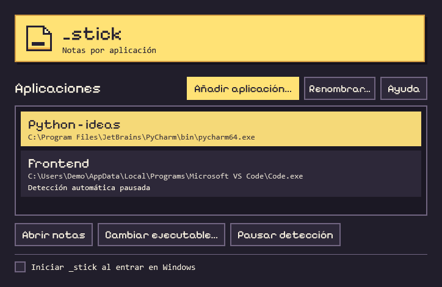

<div align="center">
  
  <h1>_stick</h1>
  <p><strong>Notas de escritorio vinculadas a aplicaciones de Windows</strong></p>
  <p>C# · WPF · .NET 10</p>
  <p>
    <a href="#puesta-en-marcha">Puesta en marcha</a> ·
    <a href="#arquitectura">Arquitectura</a> ·
    <a href="#hoja-de-ruta">Hoja de ruta</a>
  </p>
</div>

---

## Descripción

`_stick` es una aplicación de escritorio que organiza notas en bibliotecas asociadas a ejecutables de Windows. Las notas de cada biblioteca aparecen al iniciarse la aplicación vinculada y se cierran al terminar su último proceso. El contenido se almacena localmente y se recupera al volver a abrir la biblioteca.

<p align="center">
  
  <br>
  <em>Gestor de bibliotecas con dos aplicaciones de ejemplo.</em>
</p>

## Funcionalidades

- **Gestión de bibliotecas.** Asociación por ruta del ejecutable y nombres personalizables en el gestor, la bandeja y el encabezado de las notas.
- **Integración con Windows.** Detección automática de procesos, apertura manual desde la bandeja y arranque opcional al iniciar sesión. La detección se puede pausar por biblioteca.
- **Personalización y persistencia.** Notas desplazables y redimensionables, con guardado automático del texto, el color y las dimensiones.
- **Markdown en vivo.** Vista previa de encabezados, negrita, cursiva, listas y código en línea. La línea activa muestra la sintaxis original durante la edición.

## Puesta en marcha

**Requisitos** · Windows y SDK de .NET 10. Para trabajar en Visual Studio se requiere la carga de trabajo **Desarrollo de escritorio de .NET**.

En Visual Studio, abrir [`_stick.csproj`](_stick.csproj) y ejecutar con **F5**. Como alternativa, iniciar desde PowerShell en la raíz del proyecto.

```powershell
dotnet run --project _stick.csproj
```

### Uso básico

1. En **Aplicaciones**, seleccionar **Añadir aplicación…** y elegir un ejecutable. El botón **Ayuda** incluye instrucciones para localizarlo.
2. Seleccionar **Renombrar…** para asignar un nombre a la biblioteca. Utilizar **Abrir notas** para acceder a ella manualmente.
3. Iniciar y cerrar la aplicación vinculada para comprobar el comportamiento automático. Al iniciarla de nuevo, se recuperan el texto, el color y el tamaño de las notas.

## Arquitectura

La interfaz utiliza WPF y XAML. La bandeja del sistema y el selector de color se integran mediante componentes de Windows Forms.

| Componente | Archivos | Responsabilidad |
| --- | --- | --- |
| Ciclo de vida | [`App.xaml.cs`](App.xaml.cs), [`ProcessMonitor.cs`](ProcessMonitor.cs) | Detección de procesos por ruta y coordinación de ventanas. |
| Gestión de bibliotecas | [`CollectionsWindow.xaml`](CollectionsWindow.xaml), [`CollectionsWindow.xaml.cs`](CollectionsWindow.xaml.cs) | Alta y configuración de bibliotecas vinculadas. |
| Editor de notas | [`NoteWindow.xaml`](NoteWindow.xaml), [`NoteViewModel.cs`](NoteViewModel.cs) | Presentación, edición y gestión del tamaño de cada nota. |
| Vista previa de Markdown | [`MarkdownLine.cs`](MarkdownLine.cs), [`MarkdownPreview.cs`](MarkdownPreview.cs) | Análisis y presentación del formato sin modificar el texto fuente. |
| Datos y persistencia | [`Models.cs`](Models.cs), [`LocalStore.cs`](LocalStore.cs) | Modelos de notas y bibliotecas, lectura y escritura del archivo JSON. |

El archivo de datos se guarda por usuario en `%LOCALAPPDATA%\_stick\notes.json`, fuera del repositorio.

## Hoja de ruta

| Mejora propuesta | Criterio de aceptación |
| --- | --- |
| Persistencia de la posición de las notas | Una nota reaparece en la posición guardada al volver a abrir su biblioteca. |
| Selección de aplicaciones en ejecución | Una aplicación se puede vincular desde una lista de procesos activos y su biblioteca se abre al reiniciarla. |
| Exportación a Markdown | Las notas de una biblioteca se exportan a archivos `.md` que conservan su contenido y sintaxis. |

## Documentación

La [guía técnica para Obsidian](<Guia de _stick para Obsidian.md>) documenta las clases y los métodos, el ciclo de vida de las notas y el flujo de guardado. Incluye ejercicios de depuración y los pasos para trasladar el proyecto a otro repositorio.

---

**Créditos.** La ventana principal usa [Pixelify Sans](https://fonts.google.com/specimen/Pixelify+Sans). Su [licencia SIL Open Font License](Assets/Fonts/PixelifySans-OFL.txt) está incluida en el proyecto.
