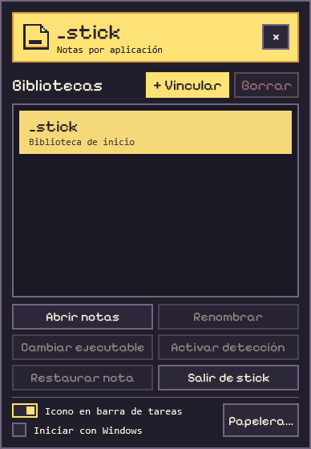
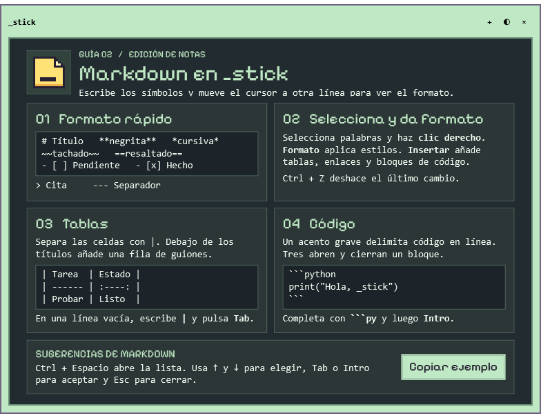
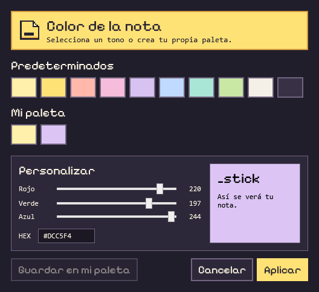
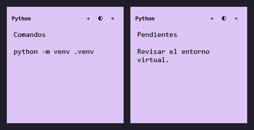
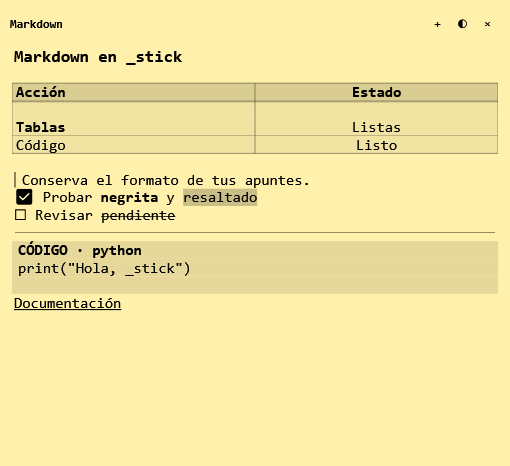
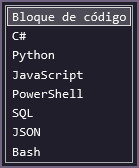
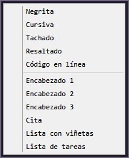
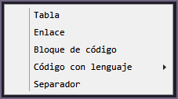
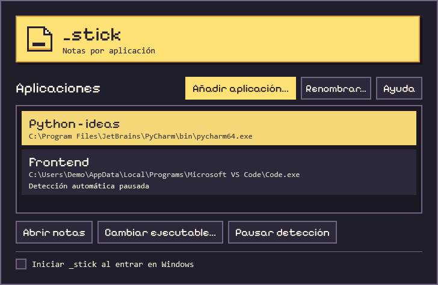
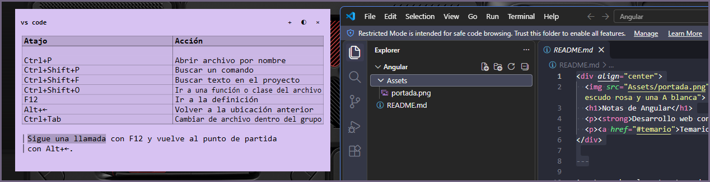

<div align="center">
  <h1></h1>
  <p><strong>Notas de escritorio vinculadas a aplicaciones de Windows</strong></p>
  <p>C# · WPF · .NET 10</p>
  <p>
    <a href="#estructura-del-repositorio">Estructura</a> ·
    <a href="#capturas">Capturas</a> ·
    <a href="#puesta-en-marcha">Puesta en marcha</a> ·
    <a href="#arquitectura">Arquitectura</a> ·
    <a href="#evolución-del-proyecto">Evolución</a> ·
    <a href="#hoja-de-ruta">Hoja de ruta</a>
  </p>
</div>

---

## Descripción

`_stick` es una aplicación de escritorio que organiza notas en bibliotecas asociadas a ejecutables de Windows. Las notas de cada biblioteca aparecen al iniciarse la aplicación vinculada y se cierran al terminar su último proceso. El contenido se almacena localmente y se recupera al volver a abrir la biblioteca.

## Estructura del repositorio

| Carpeta | Contenido |
| --- | --- |
| [`_stick/proyecto/`](proyecto/) | Código fuente de la aplicación, ventanas WPF y archivos de compilación. El punto de entrada para abrir y compilar el código en Visual Studio es [`_stick.csproj`](proyecto/_stick.csproj). |
| [`_stick/ejemplos_notas/`](ejemplos_notas/) | Notas de muestra en Markdown para ChatGPT, Chrome, Obsidian, PyCharm, Visual Studio Code y Windows. Se pueden copiar al editor de `_stick` para probar su formato y usarlas como punto de partida. |
| [`_stick/assets/`](assets/) | Material gráfico del repositorio. El logo y las capturas de esta página están en [`assets/readme/`](assets/readme/). |

Los recursos que usa la aplicación al ejecutarse (el icono y la fuente) están en [`proyecto/assets/`](proyecto/assets/), junto al código. Las notas personales se guardan en `%LOCALAPPDATA%\_stick`, fuera del repositorio.

## Capturas

### Panel de bibliotecas

El panel se abre en la esquina inferior derecha. El interruptor **Icono en barra de tareas**, al pie del panel, permite elegir desde dónde volver a abrirlo. Está activado por defecto y recuerda el estado entre sesiones.

- **Activado.** Al cerrar el panel, se minimiza. Un clic en el icono de `_stick` en la barra de tareas lo restaura.
- **Desactivado.** El icono se oculta de la barra de tareas. El panel se puede reabrir desde la bandeja o ejecutando `_stick.exe` otra vez.

Las notas de la biblioteca `_stick` siguen visibles al cerrar el panel en ambos modos.

<p align="center">
  
</p>

### Tutorial de bienvenida en dos pasos

La nota amarilla explica cómo vincular aplicaciones, ocultar notas y moverlas a la papelera. Las tres viñetas se animan al pasar el puntero por encima.

<p align="center">
  
</p>

Al cerrar la nota amarilla con **×**, aparece en el mismo sitio la guía verde de Markdown. Incluye ejemplos de tablas y código, atajos para el autocompletado y un botón **Copiar ejemplo**.

<p align="center">
  
</p>

### Primera vinculación

El selector explica cómo asociar una aplicación abierta a una biblioteca. **Buscar archivo…** permite elegir un ejecutable manualmente y **Ayuda** explica cómo localizarlo en Windows.

<p align="center">
  
</p>

### Color de la nota

El selector combina colores predeterminados con controles RGB, un campo HEX y una vista previa. **Guardar en mi paleta** conserva la muestra para otras notas. **Aplicar** cambia el color del post-it abierto.

<p align="center">
  
</p>

Al pulsar **+** en una nota, el nuevo post-it hereda su color y aparece al lado si hay espacio.

<p align="center">
  
</p>

### Edición Markdown

La vista previa muestra tablas, bloques de código, listas de tareas, citas y formato de texto. La línea activa conserva la sintaxis mientras se edita.

<p align="center">
  
</p>

El autocompletado propone plantillas según el marcador escrito. El menú de clic derecho permite dar formato a la selección o insertar elementos Markdown.

<table align="center">
  <tr>
    <th>Autocompletado</th>
    <th>Menú de formato</th>
    <th>Menú de inserción</th>
  </tr>
  <tr>
    <td align="center"></td>
    <td align="center"></td>
    <td align="center"></td>
  </tr>
</table>

## Funcionalidades

- **Gestión de bibliotecas.** Selector de aplicaciones abiertas, búsqueda manual por archivo y nombres personalizables para las bibliotecas vinculadas, visibles en el panel y el encabezado de las notas.
- **Integración con Windows.** El panel se muestra al arrancar y se puede volver a abrir desde la barra de tareas, la bandeja o ejecutando `_stick.exe` de nuevo. La detección automática se puede pausar por biblioteca y el inicio con Windows es opcional.
- **Biblioteca de inicio.** Incluye dos notas de bienvenida, una sobre el uso de las notas y la papelera y otra sobre Markdown.
- **Colores de las notas.** Paleta personal persistente, edición RGB y HEX, y herencia del color al crear una nota con **+**.
- **Personalización y persistencia.** Las notas guardan el texto, el color, las dimensiones y la última posición. Al volver a abrir una aplicación vinculada, sus post-its recuperan su sitio.
- **Movimiento en grupo y papelera.** `Ctrl` + arrastrar mueve las notas visibles de una biblioteca. En un arrastre individual, soltar sobre la papelera permite retirar una nota. **Restaurar nota** recupera la última retirada de la biblioteca seleccionada. Su posición y tamaño se ajustan en **Papelera…**.
- **Markdown en vivo.** Tablas con alineación de columnas, bloques de código, tareas, citas, separadores, enlaces y formato de texto. Incluye sugerencias contextuales y un menú de formato e inserción.

## Puesta en marcha

**Requisitos** · Windows y SDK de .NET 10. Para trabajar en Visual Studio se requiere la carga de trabajo **Desarrollo de escritorio de .NET**.

En Visual Studio, abrir [`_stick.csproj`](proyecto/_stick.csproj) y ejecutar con **F5**. Como alternativa, iniciar desde PowerShell en la raíz del repositorio.

```powershell
dotnet run --project ./proyecto/_stick.csproj
```

### Uso básico

1. Abrir la aplicación que se desea vincular. En `_stick`, seleccionar **+ Vincular**, elegirla en la lista y pulsar **Vincular**. El selector muestra un tutorial la primera vez y permite actualizar la lista o buscar un archivo `.exe`. El botón **Ayuda** del selector explica cómo encontrarlo.
2. Seleccionar **Renombrar** para asignar un nombre a la biblioteca. Utilizar **Abrir notas** para acceder a ella manualmente.
3. Iniciar y cerrar la aplicación vinculada para comprobar el comportamiento automático. Al iniciarla de nuevo, se recuperan el texto, el color, el tamaño y la posición de las notas.
4. Para desvincular una aplicación y eliminar definitivamente todas sus notas, seleccionar su biblioteca y pulsar **Borrar** junto a **+ Vincular**.

### Probar Markdown

- Escribir `|` en una línea vacía y pulsar **Tab** para insertar una tabla.
- Escribir tres acentos graves seguidos de `py` y pulsar **Intro** para insertar un bloque de código Python.
- Seleccionar texto y abrir el menú de clic derecho para usar **Formato** o **Insertar**. **Ctrl + Espacio** abre las sugerencias manualmente.

## Arquitectura

La interfaz utiliza WPF y XAML. La bandeja del sistema se integra mediante Windows Forms.

| Componente | Archivos | Responsabilidad |
| --- | --- | --- |
| Ciclo de vida | [`App.xaml.cs`](proyecto/App.xaml.cs), [`ProcessMonitor.cs`](proyecto/ProcessMonitor.cs) | Detección de procesos por ruta y coordinación de ventanas. |
| Gestión de bibliotecas | [`CollectionsWindow.xaml`](proyecto/CollectionsWindow.xaml), [`AppPickerWindow.xaml`](proyecto/AppPickerWindow.xaml) | Selección de aplicaciones abiertas y configuración de bibliotecas vinculadas. |
| Editor de notas | [`NoteWindow.xaml`](proyecto/NoteWindow.xaml), [`NoteViewModel.cs`](proyecto/NoteViewModel.cs) | Presentación, edición y gestión del tamaño de cada nota. |
| Selector de color | [`NoteColorPickerWindow.xaml`](proyecto/NoteColorPickerWindow.xaml) | Elección de tonos, vista previa y gestión de la paleta personal. |
| Guías de bienvenida | [`WelcomeNoteView.xaml`](proyecto/WelcomeNoteView.xaml), [`MarkdownGuideView.xaml`](proyecto/MarkdownGuideView.xaml) | Tutorial de uso general y guía de edición Markdown. |
| Vista previa de Markdown | [`MarkdownLine.cs`](proyecto/MarkdownLine.cs), [`MarkdownPreview.cs`](proyecto/MarkdownPreview.cs) | Análisis y presentación del formato sin modificar el texto fuente. |
| Edición Markdown | [`MarkdownEditing.cs`](proyecto/MarkdownEditing.cs) | Menú de formato, sugerencias y plantillas de inserción. |
| Datos y persistencia | [`Models.cs`](proyecto/Models.cs), [`LocalStore.cs`](proyecto/LocalStore.cs) | Modelos de notas y bibliotecas, lectura y escritura del archivo JSON. |

Los datos se guardan por usuario en `%LOCALAPPDATA%\_stick`. `notes.json` contiene las notas y sus posiciones. `colors.json` contiene la paleta personal.

## Evolución del proyecto

| Etapa | Cambios incorporados |
| --- | --- |
| **0.1 Preview** | Bibliotecas asociadas por ruta del ejecutable. Detección del inicio y cierre de aplicaciones, guardado local de notas y vista previa de Markdown durante la edición. |
| **Gestión de notas** | Movimiento en grupo con `Ctrl` y papelera al arrastrar. Las notas retiradas se pueden restaurar y el usuario puede ajustar la posición y el tamaño de la papelera. |
| **Vinculación guiada** | Selector de aplicaciones abiertas, búsqueda manual de ejecutables y tutorial para crear la primera biblioteca. |
| **Panel de bandeja y bienvenida** | El gestor ancho dio paso a un panel compacto en la esquina inferior derecha. Se incorporó la biblioteca propia de `_stick` con un tutorial ilustrado y animado. |
| **Acceso al panel y gestión de bibliotecas** | Un clic en el icono de la bandeja o volver a ejecutar `_stick.exe` abre el panel. Las notas de inicio siguen abiertas al cerrar el menú. **Borrar** desvincula una aplicación y elimina sus notas tras una confirmación. |
| **Icono en la barra de tareas** | Un interruptor persistente permite mantener un botón en la barra de tareas y restaurar el panel minimizado aunque la bandeja esté oculta. |
| **Paleta y posición de notas** | Selector de color integrado, colores propios reutilizables y nuevas notas del mismo color al pulsar **+**. Las notas recuperan su posición al reabrir la aplicación vinculada. |
| **Edición Markdown y segunda guía** | Tablas, bloques de código, autocompletado contextual y menú de formato. La guía verde aparece al cerrar la nota amarilla. |

<details>
  <summary>Ver el gestor de aplicaciones de la versión anterior</summary>
  <p align="center">
    
  </p>
</details>

## Hoja de ruta

| Mejora propuesta | Criterio de aceptación |
| --- | --- |
| Exportación a Markdown | Las notas de una biblioteca se exportan a archivos `.md` que conservan su contenido y sintaxis. |

## Documentación

La [guía técnica para Obsidian](<proyecto/Guia de _stick para Obsidian.md>) documenta las clases y los métodos, el ciclo de vida de las notas y el flujo de guardado. Incluye ejercicios de depuración y los pasos para trasladar el proyecto a otro repositorio.

## _stick en uso

Una nota de la biblioteca de Visual Studio Code muestra una tabla de atajos junto al editor. El contenido de esta captura parte de las [notas de ejemplo](ejemplos_notas/).

<p align="center">
  
</p>

---

**Créditos.** La ventana principal usa [Pixelify Sans](https://fonts.google.com/specimen/Pixelify+Sans). Su [licencia SIL Open Font License](proyecto/assets/fonts/PixelifySans-OFL.txt) está incluida en el proyecto.
