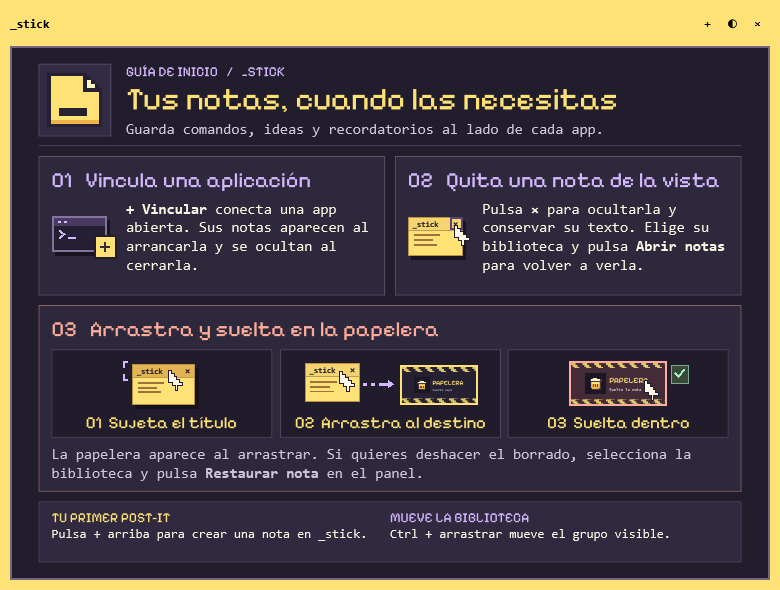
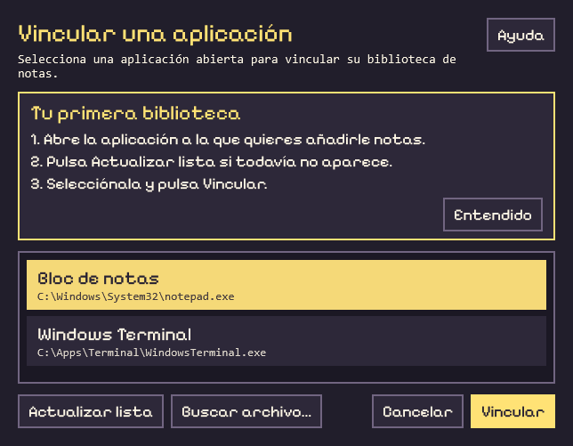

<div align="center">
  
  <h1>_stick</h1>
  <p><strong>Notas de escritorio vinculadas a aplicaciones de Windows</strong></p>
  <p>C# · WPF · .NET 10</p>
  <p>
    <a href="#capturas">Capturas</a> ·
    <a href="#puesta-en-marcha">Puesta en marcha</a> ·
    <a href="#arquitectura">Arquitectura</a> ·
    <a href="#evolución-del-proyecto">Evolución</a> ·
    <a href="#hoja-de-ruta">Hoja de ruta</a>
  </p>
</div>

---

## Descripción

`_stick` es una aplicación de escritorio que organiza notas en bibliotecas asociadas a ejecutables de Windows. Las notas de cada biblioteca aparecen al iniciarse la aplicación vinculada y se cierran al terminar su último proceso. El contenido se almacena localmente y se recupera al volver a abrir la biblioteca.

## Capturas

### Panel de bibliotecas

El panel se abre en la esquina inferior derecha desde el icono de la bandeja. Desde aquí se vinculan aplicaciones, se abren sus notas y se ajusta la papelera. Al cerrar el panel, las notas de la biblioteca `_stick` siguen visibles.

<p align="center">
  
</p>

### Nota de bienvenida

La biblioteca `_stick` incluye una guía centrada que explica cómo vincular aplicaciones, ocultar una nota y moverla a la papelera. Las tres viñetas se animan al pasar el puntero por encima.

<p align="center">
  
</p>

### Primera vinculación

El selector explica cómo asociar una aplicación abierta a una biblioteca. **Buscar archivo…** permite elegir un ejecutable manualmente y **Ayuda** explica cómo localizarlo en Windows.

<p align="center">
  
</p>

## Funcionalidades

- **Gestión de bibliotecas.** Selector de aplicaciones abiertas, búsqueda manual por archivo y nombres personalizables para las bibliotecas vinculadas, visibles en el panel y el encabezado de las notas.
- **Integración con Windows.** El panel se muestra al arrancar y se puede volver a abrir con un clic en el icono junto al reloj o ejecutando de nuevo `_stick.exe`. La detección automática se puede pausar por biblioteca y el inicio con Windows es opcional.
- **Biblioteca de inicio.** `_stick` incluye una biblioteca propia con una guía ilustrada y animada que explica cómo vincular aplicaciones, ocultar notas y usar la papelera.
- **Personalización y persistencia.** Notas desplazables y redimensionables, con guardado automático del texto, el color y las dimensiones.
- **Movimiento en grupo y papelera.** `Ctrl` + arrastrar mueve las notas visibles de una biblioteca. En un arrastre individual, soltar sobre la papelera permite retirar una nota. **Restaurar nota** recupera la última retirada de la biblioteca seleccionada. Su posición y tamaño se ajustan en **Papelera…**.
- **Markdown en vivo.** Vista previa de encabezados, negrita, cursiva, listas y código en línea. La línea activa muestra la sintaxis original durante la edición.

## Puesta en marcha

**Requisitos** · Windows y SDK de .NET 10. Para trabajar en Visual Studio se requiere la carga de trabajo **Desarrollo de escritorio de .NET**.

En Visual Studio, abrir [`_stick.csproj`](proyecto/_stick.csproj) y ejecutar con **F5**. Como alternativa, iniciar desde PowerShell en la raíz del repositorio.

```powershell
dotnet run --project ./proyecto/_stick.csproj
```

### Uso básico

1. Abrir la aplicación que se desea vincular. En `_stick`, seleccionar **+ Vincular**, elegirla en la lista y pulsar **Vincular**. El selector muestra un tutorial la primera vez y permite actualizar la lista o buscar un archivo `.exe`. El botón **Ayuda** del selector explica cómo encontrarlo.
2. Seleccionar **Renombrar** para asignar un nombre a la biblioteca. Utilizar **Abrir notas** para acceder a ella manualmente.
3. Iniciar y cerrar la aplicación vinculada para comprobar el comportamiento automático. Al iniciarla de nuevo, se recuperan el texto, el color y el tamaño de las notas.
4. Para desvincular una aplicación y eliminar definitivamente todas sus notas, seleccionar su biblioteca y pulsar **Borrar** junto a **+ Vincular**.

## Arquitectura

La interfaz utiliza WPF y XAML. La bandeja del sistema y el selector de color se integran mediante componentes de Windows Forms.

| Componente | Archivos | Responsabilidad |
| --- | --- | --- |
| Ciclo de vida | [`App.xaml.cs`](proyecto/App.xaml.cs), [`ProcessMonitor.cs`](proyecto/ProcessMonitor.cs) | Detección de procesos por ruta y coordinación de ventanas. |
| Gestión de bibliotecas | [`CollectionsWindow.xaml`](proyecto/CollectionsWindow.xaml), [`AppPickerWindow.xaml`](proyecto/AppPickerWindow.xaml) | Selección de aplicaciones abiertas y configuración de bibliotecas vinculadas. |
| Editor de notas | [`NoteWindow.xaml`](proyecto/NoteWindow.xaml), [`NoteViewModel.cs`](proyecto/NoteViewModel.cs) | Presentación, edición y gestión del tamaño de cada nota. |
| Guía de bienvenida | [`WelcomeNoteView.xaml`](proyecto/WelcomeNoteView.xaml) | Tutorial ilustrado que se muestra dentro de la nota inicial. |
| Vista previa de Markdown | [`MarkdownLine.cs`](proyecto/MarkdownLine.cs), [`MarkdownPreview.cs`](proyecto/MarkdownPreview.cs) | Análisis y presentación del formato sin modificar el texto fuente. |
| Datos y persistencia | [`Models.cs`](proyecto/Models.cs), [`LocalStore.cs`](proyecto/LocalStore.cs) | Modelos de notas y bibliotecas, lectura y escritura del archivo JSON. |

El archivo de datos se guarda por usuario en `%LOCALAPPDATA%\_stick\notes.json`, fuera del repositorio.

## Evolución del proyecto

| Etapa | Cambios incorporados |
| --- | --- |
| **0.1 Preview** | Bibliotecas asociadas por ruta del ejecutable. Detección del inicio y cierre de aplicaciones, guardado local de notas y vista previa de Markdown durante la edición. |
| **Gestión de notas** | Movimiento en grupo con `Ctrl` y papelera al arrastrar. Las notas retiradas se pueden restaurar y el usuario puede ajustar la posición y el tamaño de la papelera. |
| **Vinculación guiada** | Selector de aplicaciones abiertas, búsqueda manual de ejecutables y tutorial para crear la primera biblioteca. |
| **Panel de bandeja y bienvenida** | El gestor ancho dio paso a un panel compacto en la esquina inferior derecha. Se incorporó la biblioteca propia de `_stick` con un tutorial ilustrado y animado. |
| **Acceso al panel y gestión de bibliotecas** | Un clic en el icono o volver a ejecutar `_stick.exe` abre el panel. Las notas de inicio siguen abiertas al cerrar el menú. **Borrar** desvincula una aplicación y elimina sus notas tras una confirmación. |

<details>
  <summary>Ver el gestor de aplicaciones de la versión anterior</summary>
  <p align="center">
    
  </p>
</details>

## Hoja de ruta

| Mejora propuesta | Criterio de aceptación |
| --- | --- |
| Persistencia de la posición de las notas | Una nota reaparece en la posición guardada al volver a abrir su biblioteca. |
| Exportación a Markdown | Las notas de una biblioteca se exportan a archivos `.md` que conservan su contenido y sintaxis. |

## Documentación

La [guía técnica para Obsidian](<proyecto/Guia de _stick para Obsidian.md>) documenta las clases y los métodos, el ciclo de vida de las notas y el flujo de guardado. Incluye ejercicios de depuración y los pasos para trasladar el proyecto a otro repositorio.

---

**Créditos.** La ventana principal usa [Pixelify Sans](https://fonts.google.com/specimen/Pixelify+Sans). Su [licencia SIL Open Font License](proyecto/Assets/Fonts/PixelifySans-OFL.txt) está incluida en el proyecto.
