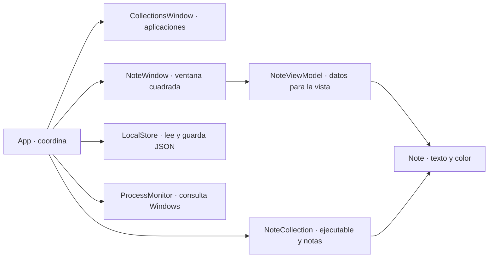
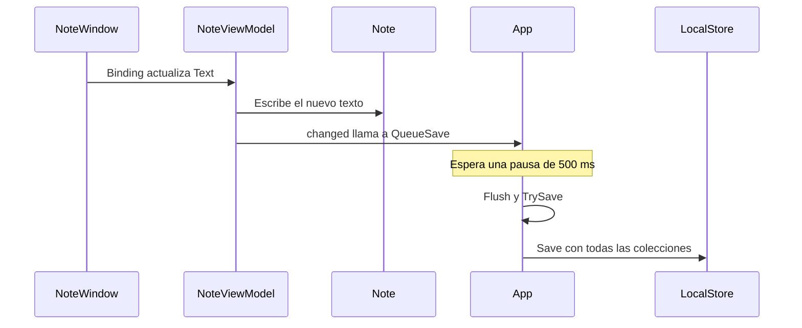

---
aliases:
  - Manual de _stick
  - Arquitectura de _stick
tags:
  - wpf
  - csharp
  - aprendizaje
---

# Entender _stick desde cero

En `_stick` eliges una aplicación abierta por su nombre. El selector obtiene la ruta de su ejecutable, por ejemplo `pycharm64.exe`. `_stick` permanece en la bandeja de Windows y comprueba si ese programa se está ejecutando. Cuando detecta su arranque abre su biblioteca, y cuando termina el último proceso cierra sus ventanas. Cada nota tiene su propia ventana y lleva en el encabezado el nombre de la biblioteca. Al arrancar, el panel aparece abajo a la derecha y la nota de bienvenida de `_stick` se abre en el centro. Un clic en el icono de la bandeja vuelve a mostrar el panel. La asociación, el nombre y los datos de las notas se guardan en un archivo de tu equipo.

> [!tip] Cómo leer esta guía
> Abre esta nota en Obsidian y el proyecto en Visual Studio. Lee cada sección con el archivo correspondiente a la vista. Puedes usar el índice para volver directamente a un método o a un recorrido cuando empieces a modificar el proyecto.

## Índice

1. [[#1. Cómo se organiza el proyecto|Estructura y archivos]]
2. [[#2. El vocabulario que usa el código|Fundamentos de C# y WPF]]
3. [[#3. Note y NoteCollection|Los datos de una nota y su colección]]
4. [[#4. LocalStore|Guardar y cargar el archivo JSON]]
5. [[#5. ProcessMonitor|Detectar aplicaciones abiertas]]
6. [[#6. NoteViewModel|Conectar una nota con su ventana]]
7. [[#7. NoteWindow|La ventana de una nota]]
8. [[#8. CollectionsWindow|La ventana de aplicaciones]]
9. [[#9. App|Arranque, bandeja, coordinación y guardado]]
10. [[#10. Tres recorridos completos|Seguir lo que pasa al usar la aplicación]]
11. [[#11. Primeras modificaciones|Practicar con cambios pequeños]]
12. [[#12. Cómo se incorporó Markdown en vivo|La vista previa dentro del editor]]
13. [[#13. Cómo se renombra una biblioteca|Seguir el cambio de nombre paso a paso]]
14. [[#14. Trasladar el proyecto a GitHub|Qué archivos mover y cómo publicarlos]]

## 1. Cómo se organiza el proyecto

Un **proyecto** agrupa los archivos que se compilan juntos para producir una aplicación. **C#** es el lenguaje en el que están escritas las instrucciones. **.NET** aporta las herramientas para compilar el código, las bibliotecas que usa el programa y el entorno que lo ejecuta. En este caso, `_stick.csproj` le indica a .NET cómo generar el programa de escritorio. **Compilar** significa transformar el código y las definiciones de interfaz en archivos que .NET y Windows pueden ejecutar.

| Archivo | Responsabilidad |
| --- | --- |
| `_stick.csproj` | Configura el proyecto. `WinExe` genera una aplicación de Windows sin consola propia. `net10.0-windows` selecciona .NET 10 para Windows. `UseWPF` habilita las ventanas WPF y `UseWindowsForms` habilita los componentes usados para la bandeja y el selector de color. `Nullable` activa avisos del compilador sobre posibles valores `null`. |
| `App.xaml` y `App.xaml.cs` | Configuran y coordinan la aplicación entera. `App` crea las ventanas, conecta los temporizadores y decide cuándo guardar. |
| `CollectionsWindow.xaml` y `CollectionsWindow.xaml.cs` | Definen la pantalla donde vinculas ejecutables, renombras bibliotecas, abres notas y cambias el inicio automático. |
| `AppPickerWindow.xaml` y `AppPickerWindow.xaml.cs` | Muestran las aplicaciones abiertas, el tutorial inicial y la opción de buscar un archivo. |
| `PixelTheme.xaml` | Comparte la fuente pixelada, la paleta y los estilos de botones y filas entre el gestor y el selector. |
| `CollectionNameWindow.xaml` y `CollectionNameWindow.xaml.cs` | Definen el diálogo donde escribes el nombre de una biblioteca. |
| `NoteWindow.xaml` y `NoteWindow.xaml.cs` | Definen el aspecto y las interacciones de una ventana de nota. Dentro de este último archivo está la clase auxiliar `DialogOwner`. |
| `TrashDropWindow.xaml` y `TrashDropWindow.xaml.cs` | Definen la papelera pixelada que aparece durante el arrastre de una nota. |
| `TrashSettingsWindow.xaml`, `TrashLayout.cs` y `TrashDropVisual.xaml` | Permiten ajustar la posición y el tamaño. El esquema y la papelera real usan el mismo cálculo de colocación y el mismo control visual. |
| `Models.cs` | Contiene dos clases de datos, `Note` y `NoteCollection`. |
| `NoteViewModel.cs` | Expone a la ventana el texto y los colores de una nota y avisa cuando cambian. |
| `MarkdownLine.cs` y `MarkdownPreview.cs` | Interpretan Markdown y dibujan el formato sobre las líneas que quedan fuera de la edición activa. |
| `ExecutableHelpWindow.xaml` y `ExecutableHelpWindow.xaml.cs` | Contienen la guía que se abre al pulsar **Ayuda** junto a **Añadir aplicación…**. |
| `LocalStore.cs` | Convierte las colecciones a un archivo JSON y las recupera al arrancar. |
| `ProcessMonitor.cs` | Consulta qué ejecutables están activos en tu sesión de Windows. |
| `assets/` | Contiene el icono de `_stick`, la fuente Pixelify Sans y su licencia. El proyecto incorpora el icono y la fuente para que WPF pueda cargarlos como recursos. |
| `README.md` | Instrucciones breves para ejecutar y probar el proyecto. |

`bin` contiene los archivos compilados, `obj` contiene archivos intermedios que genera la compilación y `.vs` guarda estado local de Visual Studio. Para cambiar el programa, edita los archivos de la tabla. `.gitignore` indica a Git qué archivos generados debe ignorar.

**WPF** es la biblioteca de .NET que construye las ventanas, los botones y los cuadros de texto. **Windows Forms** es otra biblioteca de escritorio de .NET. Este proyecto usa su icono de bandeja y su selector de color dentro de una aplicación cuya interfaz principal es WPF.

`_stick` aplica parte de **MVVM**, que separa los **modelos** de datos, las **vistas** visibles y los **modelos de vista** que adaptan los datos a la interfaz. En la nota se ve la separación `Note → NoteViewModel → NoteWindow`. En el gestor de aplicaciones, `CollectionsWindow` expone algunas propiedades directamente al XAML. Los clics se conectan con métodos en los archivos `.xaml.cs`, y `App` centraliza la coordinación.



Cada flecha indica una relación del código. Por ejemplo, `App` crea una `NoteWindow` y esta recibe un `NoteViewModel`. En ejecución puede haber muchas notas en memoria, una ventana por cada nota visible y un solo gestor de aplicaciones.

## 2. El vocabulario que usa el código

### Leer una clase de C#

Una **clase** describe qué datos y operaciones tiene un tipo de objeto. Un **objeto** es una instancia concreta de esa clase. `new Note()` crea una nota vacía. Si lo ejecutas dos veces, obtienes dos notas distintas aunque su texto y su color inicial sean iguales.

- Un **campo** es una variable declarada dentro de una clase. Por ejemplo, `App` guarda su temporizador en el campo `scanTimer`. `readonly` impide reasignar el campo tras inicializarlo. El temporizador que guarda puede seguir arrancando y deteniéndose.
- Una **propiedad** expone un valor. En `Text { get; set; }`, `get` permite leerlo y `set` permite escribirlo. Una propiedad también puede calcular su resultado, como `NoteCollection.Name`.
- Un **método** realiza una operación. En `bool SetStartup(bool enabled)`, el primer `bool` es el tipo del resultado, `SetStartup` es el nombre y `enabled` es el dato que recibe. `bool` admite `true` o `false`. Un método con `void` termina sin devolver un valor.
- Un **constructor** prepara un objeto al crearlo. Se llama como la clase. También puede escribirse junto al nombre de la clase, como en `LocalStore(string filePath)`. Esa forma se llama constructor primario.
- `public`, `internal`, `private` y `protected` controlan desde dónde se puede acceder a un miembro. Aquí puedes leerlos, respectivamente, como acceso general según la visibilidad del tipo, dentro del proyecto compilado, dentro de la clase y desde la clase o sus derivadas. `sealed` impide crear una clase que herede de esa clase.
- `:` introduce una clase base o una interfaz. `NoteWindow : Window` significa que la nota hereda operaciones de WPF como `Show()` y `Close()`. Una **interfaz** describe un contrato. `INotifyPropertyChanged` exige un evento que avise de cambios en propiedades.
- `static` indica que el miembro pertenece a la clase en conjunto. Por ejemplo, `Path.Combine(...)` se llama usando el nombre del tipo, sin crear un objeto `Path`. `const` indica un valor fijo conocido al compilar.
- `namespace _stick;` agrupa los tipos propios bajo el nombre `_stick`. Los `using` del principio del archivo permiten escribir nombres cortos de tipos externos. `using Forms = System.Windows.Forms;` crea el alias `Forms`.

### Leer expresiones habituales

| Forma | Cómo leerla en el proyecto |
| --- | --- |
| `var window = ...` | C# deduce el tipo a partir del valor inicial. La variable tiene un tipo concreto. |
| `new Note { Text = "Hola" }` | Crea un objeto y establece sus propiedades iniciales. `new(...)` puede omitir el nombre del tipo cuando se deduce del contexto. |
| `List<Note>`, `HashSet<int>`, `Dictionary<string, HashSet<int>>` | Una lista ordenada de notas, un conjunto de enteros únicos y una tabla que asocia una cadena a un conjunto de enteros. Los tipos entre `< >` indican qué contiene la estructura. `[]` puede crear una colección vacía del tipo esperado. |
| `string?`, `?.`, `??` | `string?` admite ausencia de valor, `null`. `?.` intenta acceder solo si hay objeto. `??` ofrece un valor de respaldo si el primero es `null`. |
| `monitor!`, `Path.GetDirectoryName(filePath)!` | El `!` al final le dice al compilador que el autor espera un valor presente. La comprobación depende de cómo se inicializó el objeto o la ruta. |
| `!dirty`, `&&`, `\|\|`, `condición ? a : b` | Negación, «y», «o» y elección entre dos valores. `&&` y `\|\|` pueden saltarse la parte derecha si el resultado ya está decidido. |
| `expr is string path`, `as NoteCollection` | La primera forma comprueba el tipo y declara `path` si coincide. La segunda intenta tratar un objeto como `NoteCollection` y da `null` si no corresponde. |
| `out var ids` | El método puede asignar un valor a `ids` y devolver otro resultado. `TryGetValue` devuelve si encontró la clave y entrega su valor mediante `ids`. |
| `() => AddNote(...)` | Una **lambda**, una función corta que se puede guardar y ejecutar después. `Action` es el tipo de una función sin parámetros y sin resultado. `=>` también sirve para escribir métodos y propiedades de una sola expresión. |
| `(_, _) => Scan()` | Una lambda que recibe los dos datos de un evento y los descarta porque la operación solo necesita llamar a `Scan()`. |
| `try`, `catch ... when`, `throw` | `try` rodea una operación que puede fallar. `catch` maneja el fallo si cumple el filtro `when`. `throw` comunica un fallo mediante una excepción, un objeto que describe el error. |
| `using var file = ...` | Al salir del bloque se llama a `Dispose()` para liberar el recurso. Para un archivo, esto cierra el acceso que el programa mantenía abierto. |
| `$"Nota de {name}"`, `@"C:\Carpeta"` | `$` inserta valores en el texto. `@` permite escribir barras invertidas de una ruta directamente. Ambas formas se pueden combinar. |

También verás operaciones de **LINQ**, una forma de consultar colecciones en C#. `Where` filtra, `Select` transforma cada elemento, `Distinct` elimina repetidos y `Any` comprueba si al menos un elemento cumple una condición. `ToArray` materializa el resultado en ese momento y `ToHashSet` lo convierte en conjunto.

### Pasar de XAML a C#

**XAML** describe la interfaz con etiquetas y atributos. `<Button Content="+" Click="New_Click"/>` crea un botón con el texto **+** y conecta su evento de clic con el método `New_Click` de C#. Un **evento** es un aviso al que se puede suscribir código mediante `+=`. Cuando el clic ocurre, WPF llama al manejador. En `object sender, RoutedEventArgs e`, `sender` identifica el objeto en el que está registrado el manejador y `e` contiene información del evento. WPF puede propagar ciertos eventos por la jerarquía de controles.

En la etiqueta raíz, `x:Class="_stick.NoteWindow"` conecta el XAML con la clase de C#. `xmlns` declara el vocabulario de WPF y `xmlns:x` habilita atributos especiales como `x:Class` y `x:Name`. La palabra `partial` permite que una clase tenga una parte escrita a mano y otra generada durante la compilación. De ahí salen `InitializeComponent()` y los campos de los controles con `x:Name`. `InitializeComponent()` carga los controles, sus propiedades y las conexiones declaradas en XAML.

Un **enlace de datos** o *binding* conecta una propiedad del control con una propiedad de otro objeto. `DataContext` indica qué objeto consultar por defecto. Los controles hijos lo heredan habitualmente. Por ejemplo, el editor de una nota hereda como contexto su `NoteViewModel`, de modo que `{Binding Text}` se refiere a `NoteViewModel.Text`.

Cuando el objeto implementa `INotifyPropertyChanged`, WPF puede escuchar su evento `PropertyChanged` y volver a leer la propiedad anunciada. `nameof(Text)` produce la cadena `"Text"` a partir del identificador del código. `PropertyChanged?.Invoke(...)` envía el aviso si alguien está suscrito.

## 3. Note y NoteCollection

Las dos clases están en `Models.cs`. Se llaman **modelos** porque representan los datos con los que trabaja la aplicación.

### Note

| Propiedad | Qué guarda |
| --- | --- |
| `Text` | El texto de la nota. Al crearla empieza como una cadena vacía, `""`. |
| `Color` | El color en forma de texto hexadecimal. El valor inicial `#FFF0AB` representa un amarillo claro. En `#RRGGBB` cada pareja corresponde a rojo, verde y azul. El selector guarda `#RRGGBB`. La lectura también admite el formato anterior `#AARRGGBB`, que añade la opacidad. |
| `Width` y `Height` | Ancho y alto de la última ventana guardada. Ambos toman `Note.DefaultSize` (240) en notas nuevas y en archivos anteriores que aún carecen de estas propiedades. |

`Left` y `Top` guardan la esquina de la ventana en píxeles del escritorio. En las notas antiguas faltan esos campos, así que `App` calcula una posición inicial. Al reabrir una nota con posición guardada, `NoteWindow` la ajusta al área de trabajo del monitor disponible.

### NoteCollection

| Propiedad | Qué guarda o calcula |
| --- | --- |
| `Executable` | Ruta completa del ejecutable asociado. `required` exige proporcionarla al crear el objeto en C# y `set` permite reemplazarla después. |
| `CustomName` | Nombre escrito por el usuario. Es nullable, así que puede contener `null` para usar el nombre del ejecutable. `[JsonIgnore(Condition = JsonIgnoreCondition.WhenWritingNull)]` omite esta propiedad del archivo cuando no tiene valor. Los archivos anteriores se cargan con `null` por defecto. |
| `Automatic` | Indica si la colección acompaña la apertura y el cierre de la aplicación. Empieza en `true`. Pausarla pone esta propiedad en `false` y la colección sigue disponible para abrir manualmente. |
| `Notes` | Lista ordenada de las notas. `init` permite asignar la lista al construir la colección. Después se pueden añadir o quitar notas dentro de esa misma lista. |
| `TrashedNotes` | Lista de notas retiradas de la biblioteca que se pueden restaurar. Los archivos de versiones anteriores se cargan con esta lista vacía. |
| `IsBuiltIn` | Distingue la biblioteca de inicio de las bibliotecas vinculadas. Su ejecutable queda vacío y `LocalStore.Load()` admite ese valor para esta biblioteca. |
| `Name` | Nombre que se muestra en la lista, en la bandeja y en el título de cada post-it. La biblioteca de inicio se llama `_stick`. En las otras, si `CustomName` tiene texto, usa ese valor. En otro caso, `Path.GetFileNameWithoutExtension(Executable)` convierte una ruta terminada en `pycharm64.exe` en `pycharm64`. `[JsonIgnore]` omite esta propiedad calculada al guardar. |

La **ruta completa** identifica la aplicación dentro de `_stick`. Si dos ejecutables tienen el mismo nombre y están en carpetas distintas, pueden tener colecciones independientes. **Cambiar ejecutable** modifica la ruta del mismo objeto `NoteCollection`, que conserva su lista de notas.

## 4. LocalStore

`LocalStore` se ocupa de la **persistencia**, es decir, de conservar datos entre ejecuciones. Su constructor primario recibe `filePath`, la ruta del archivo. `App` le pasa una ruta bajo `%LOCALAPPDATA%\_stick\notes.json`. `%LOCALAPPDATA%` es la carpeta de datos locales de tu usuario de Windows. Puedes pegar esa ruta en la barra del Explorador de archivos después de guardar tu primera colección.

**JSON** es un formato de texto para representar datos. Las llaves delimitan un objeto y los corchetes delimitan una lista. `Options` guarda las opciones del conversor. `WriteIndented = true` añade sangría y saltos de línea para que el archivo sea legible.

```json
[
  {
    "Executable": "C:\\Herramientas\\PyCharm\\bin\\pycharm64.exe",
    "CustomName": "Python - ideas",
    "Automatic": true,
    "Notes": [
      {
        "Text": "Revisar el ejercicio de Python",
        "Color": "#FFF0AB"
      }
    ]
  }
]
```

En el ejemplo, cada `\\` del JSON representa una barra invertida de la ruta real.

### Load()

1. Abre el archivo en modo lectura con `File.OpenRead(filePath)`. Si faltan el archivo o su carpeta, devuelve una lista vacía. Así se puede arrancar por primera vez.
2. `JsonSerializer.Deserialize<List<NoteCollection>>(...)` convierte el texto del archivo en objetos de C#. A esto se le llama **deserializar**.
3. Comprueba que el resultado sea una lista válida y que las colecciones tengan ruta y lista de notas. Rechaza elementos `null` y rutas vacías. Si la forma de los datos es incorrecta, lanza `JsonException`.
4. Devuelve las colecciones. El `using var openedFile = file` asegura que se cierre el archivo al terminar, incluso si falla la lectura.

`App.OnStartup()` muestra un mensaje y detiene el arranque si ocurre un error de lectura o de formato. Esto evita que la sesión empiece con una colección vacía y luego reemplace un archivo que no pudo leer.

### Save(collections)

1. Crea la carpeta de destino si hace falta.
2. Abre `notes.json.tmp` y usa `JsonSerializer.Serialize(...)` para escribir todas las colecciones. Convertir los objetos a texto se llama **serializar**.
3. `file.Flush(flushToDisk: true)` solicita que se escriban los datos pendientes en disco. El bloque `using` cierra el temporal al terminar.
4. `File.Move(..., overwrite: true)` mueve el temporal sobre `notes.json`. Primero se escribe el archivo completo y después se sustituye la versión anterior.

`LocalStore.Save()` ejecuta la escritura cuando se lo piden. Los retrasos del guardado automático y los avisos de error se deciden en `App`.

### HasSeenAppPickerTutorial() y MarkAppPickerTutorialSeen()

El tutorial se recuerda con un archivo vacío llamado `app-picker-tutorial.seen` en la misma carpeta de datos. `AppPickerTutorialMarker` calcula su ruta. `HasSeenAppPickerTutorial()` comprueba si existe y `MarkAppPickerTutorialSeen()` lo crea. El JSON de las bibliotecas conserva su estructura.

## 5. ProcessMonitor

Un **ejecutable** es un archivo que Windows puede iniciar. Un **proceso** es una ejecución concreta de ese archivo. Su **PID** es un número que Windows usa para identificarlo mientras está activo. Una **sesión** es el entorno de Windows en el que se ejecutan los programas de un usuario conectado. Este monitor trabaja con la sesión de `_stick`.

### ProcessMonitor()

`Process.GetCurrentProcess()` obtiene información sobre el propio proceso de `_stick`. El constructor copia su `SessionId` al campo `sessionId`. El `using` libera el objeto que consultó el proceso.

### FindOpenApplications()

Recorre los procesos locales y conserva los de la misma sesión que tienen una ventana principal. Omite el proceso de `_stick`. Para cada candidato, lee la ruta de su ejecutable y un nombre a partir de su descripción o de su nombre de producto. Si faltan esos datos, usa el nombre del archivo. Usa un diccionario por ruta para que un programa con varias instancias aparezca una sola vez. Devuelve los resultados ordenados en objetos `RunningApplication`, cada uno con `Name` y `Executable`.

El selector usa este método para ofrecer aplicaciones por nombre. `FindRunning()` sigue vigilando las rutas ya vinculadas, aunque un programa oculte su ventana.

### FindRunning(executables)

El parámetro `IEnumerable<string>` acepta una secuencia de rutas que se puede recorrer. El resultado es un diccionario en el que cada ruta encontrada tiene un conjunto de PIDs.

1. Crea `watchedPaths` con las rutas vigiladas. `StringComparer.OrdinalIgnoreCase` permite comparar cadenas ignorando diferencias entre mayúsculas y minúsculas. Crea también el diccionario vacío `runningPaths`.
2. Extrae el nombre sin extensión de cada ruta y elimina nombres repetidos. `Process.GetProcessesByName(name)` busca candidatos con ese nombre.
3. Examina cada candidato. Solo lo cuenta si pertenece a la misma sesión y si `process.MainModule?.FileName`, la ruta de su ejecutable principal, aparece en `watchedPaths`. De ese modo, el nombre sirve para buscar y la ruta completa sirve para confirmar.
4. `TryGetValue` busca el conjunto de PIDs de la ruta. Si es la primera coincidencia, crea el conjunto. Luego añade `process.Id`.
5. Si un proceso desaparece durante la consulta o Windows impide leer su ruta, el bloque `catch` maneja los errores previstos y permite continuar con los demás candidatos. El `using (process)` libera cada objeto consultado. Devuelve el diccionario con lo encontrado.

> [!example] Resultado de una comprobación
> La ruta de `pycharm64.exe` podría estar asociada al conjunto `{ 1350, 6420 }` si hay dos procesos coincidentes. Una aplicación cerrada queda fuera del diccionario. `App.Scan()` usa el resultado para decidir qué colecciones abrir.

## 6. NoteViewModel

Su constructor primario recibe la `Note` que va a mostrar y una función `Action changed` que debe llamar cuando modifique esa nota. `App` le pasa `QueueSave`. Así, el modelo de vista puede solicitar que se guarden los cambios sin necesitar la ruta del archivo.

| Miembro | Qué hace |
| --- | --- |
| `PropertyChanged` | Evento de `INotifyPropertyChanged`. Avisa a WPF de qué propiedad debe volver a consultar. |
| `Text` | El `get` devuelve `note.Text`. El `set` recibe el nuevo texto en la variable especial `value`. Si coincide con el anterior, termina. Si ha cambiado, actualiza el modelo, avisa de que cambió `Text` y llama a `changed()`. |
| `Background` | Devuelve un `SolidColorBrush` con el color de `ReadColor()`. Un `Color` representa el valor del color y un `Brush` es el objeto con el que WPF pinta una superficie. El pincel sólido pinta con un solo color. |
| `Foreground` | Calcula la **luminancia**, una medida del brillo del color de fondo. Combina rojo, verde y azul con pesos distintos y elige negro para los fondos por encima del umbral `.179`, blanco para los demás. Se usa en el texto, los iconos y el cursor de escritura. |
| `SetColor(color)` | Convierte el color elegido a texto y lo asigna a `note.Color`. Notifica el cambio de `Background` y `Foreground`, ya que ambos dependen del nuevo fondo. Por último, llama a `changed()`. |
| `Width`, `Height` y `SetSize(width, height)` | Las propiedades devuelven el tamaño del modelo. `SetSize()` lo actualiza y llama a `changed()` si varía alguna dimensión. |
| `ReadColor()` | Usa `ColorConverter.ConvertFromString` para recuperar un color WPF a partir del texto guardado. Si la conversión no produce un color o lanza el error de formato previsto, devuelve `LemonChiffon`, un amarillo claro. |
| `Linear(channel)` | Convierte un canal de color de 0 a 255 a un valor proporcional a la luz. Primero divide por `255d`, que fuerza división con decimales. Después usa una fórmula para los valores pequeños y otra para el resto. `Foreground` aplica la conversión a los tres canales antes de calcular el brillo. |

La ventana recibe el modelo de vista y este conserva una referencia a la nota original de la colección. Una **referencia** permite a dos partes del programa trabajar con el mismo objeto. Al modificar `note.Text`, se modifica el objeto que luego leerá `LocalStore` al guardar.

## 7. NoteWindow

### NoteWindow.xaml

- La nota nueva mide 240 × 240 unidades independientes del dispositivo. WPF las adapta a la escala de pantalla de Windows. `MinWidth` y `MinHeight` dejan espacio para el encabezado y el editor al reducirla.
- `WindowStyle="None"` quita el marco de Windows para usar un encabezado propio. `ResizeMode="CanResize"` y `WindowChrome.ResizeBorderThickness` dejan arrastrar los bordes y las esquinas. `ShowInTaskbar="False"` evita un botón en la barra de tareas por cada nota. `Topmost="True"` la mantiene por encima de las ventanas normales. `ShowActivated="False"` hace que mostrarla no solicite el foco de teclado de entrada. Cuando el usuario abre una colección a mano, `App` sí llama a `Activate()`.
- `DockPanel` coloca el encabezado arriba y deja el espacio restante al editor. El encabezado aloja los botones a la derecha en un `StackPanel` horizontal. Su estilo local les da fondo transparente y el color de texto del modelo de vista. `Margin` da espacio alrededor de un control y `Padding` da espacio dentro.
- El título toma `Window.Title` mediante `RelativeSource`. Ese enlace busca la ventana que contiene al control. Los demás enlaces de texto y color usan el modelo de vista del `DataContext`.
- `TextBox` permite escribir varias líneas, ajustar el texto al ancho y mostrar una barra vertical cuando hace falta. `CaretBrush` pinta el indicador de dónde se insertará la siguiente letra.
- El enlace `Text="{Binding Text, UpdateSourceTrigger=PropertyChanged}"` permite editar en los dos sentidos. El editor muestra el valor del modelo de vista y actualiza esa propiedad en cada cambio de texto. El `PropertyChanged` de este atributo indica **cuándo** el control actualiza el origen. El evento `NoteViewModel.PropertyChanged` informa a la interfaz de cambios en sentido inverso.
- El `Thumb` del encabezado captura el ratón y emite eventos al comenzar, continuar y terminar el arrastre. El menú contextual ofrece **Mover a la papelera…**.
- `ToolTip` da un texto al dejar el puntero encima. `AutomationProperties.Name` describe los controles a herramientas de accesibilidad.

### NoteWindow.xaml.cs

Este archivo es el **code-behind**, la parte C# asociada al XAML que responde a interacciones de la ventana.

| Método o clase | Qué hace |
| --- | --- |
| `NoteWindow(collectionName, viewModel, addNote, deleteNote, getFamily, getTrashLayout)` | Guarda el modelo de vista y las funciones para añadir, enviar a la papelera, consultar las ventanas de la biblioteca y obtener los ajustes de la papelera. |
| `New_Click(sender, e)` | Al pulsar **+**, ejecuta `addNote()`. La función fue creada en `App.ShowNote()` con la colección concreta que corresponde a esa ventana. |
| `Hide_Click(sender, e)` | Al pulsar **×**, llama a `Close()`, heredado de `Window`. Se destruye esa ventana y se conserva el objeto `Note` dentro de su colección. |
| `Delete_Click(sender, e)` | Pide confirmación para enviar la nota a la papelera y llama a `deleteNote()` al aceptar. El guardado se hace en `App.DeleteNote()`. |
| `Color_Click(sender, e)` | Abre `NoteColorPickerWindow` con el color actual. Al pulsar **Aplicar**, asigna el color elegido al modelo de vista. |
| `PlaceBeside(parent, occupied)` | Busca un hueco a la izquierda o a la derecha de la nota original, con un margen respecto a las ventanas abiertas. Si los laterales están llenos, prueba arriba o abajo. |
| `TrackPosition(savedLeft, savedTop)` | Recupera las coordenadas guardadas y escucha `LocationChanged`. `RememberPosition()` guarda la posición de la ventana en píxeles y `SetPosition()` pide el guardado diferido. |
| `NoteColorPickerWindow` | Muestra colores predeterminados, muestras de **Mi paleta**, controles RGB, un campo HEX y una vista previa. **Guardar en mi paleta** conserva la muestra en `colors.json` para reutilizarla aunque se cierre el selector o la aplicación. |
| `CursorOnScreen()` | Lee la posición del puntero en píxeles de pantalla. |
| `Header_DragStarted(sender, e)` y `StartDrag(withControl)` | Leen Ctrl al comenzar y registran el origen del puntero y la posición de cada ventana que se va a mover. |
| `Header_DragDelta(sender, e)` y `MoveDrag(cursor)` | Calculan el desplazamiento respecto al origen y lo aplican a la nota o a las ventanas visibles de su biblioteca. El arrastre individual muestra la papelera al superar el umbral de movimiento. |
| `ShowTrash()` | Consulta el área de trabajo del monitor en el que empezó el arrastre. `TrashLayout.GetBounds()` calcula la posición y el tamaño a partir de los ajustes guardados. |
| `Header_DragCompleted(sender, e)` y `FinishDrag(canceled, cursor)` | Si el gesto se cancela, restauran las posiciones iniciales. Al soltar sobre la papelera, llaman a la acción que guarda la nota como eliminada. |
| `Window_PreviewKeyDown(sender, e)` | Cancela el arrastre al pulsar Esc. |
| `ClearDrag()` y `OnClosed(e)` | Cierran la papelera y liberan el estado temporal al terminar el gesto o cerrar la nota. |
| `OnRenderSizeChanged(sizeInfo)` | WPF lo llama al cambiar el tamaño. Si la ventana ya está cargada y en estado normal, pasa el tamaño a `viewModel.SetSize()` para guardarlo. |
| `DialogOwner(IntPtr Handle)` | Tipo auxiliar privado declarado como `record`, una forma de declarar un objeto de datos. El parámetro `Handle` genera una propiedad del mismo nombre. Implementa `Forms.IWin32Window`, la interfaz que pide el selector de color para saber qué ventana lo abre. `WindowInteropHelper(this).Handle` obtiene el identificador nativo de la ventana WPF y `IntPtr` lo representa en C#. Así el diálogo queda asociado a la nota que lo abrió. |

### TrashDropWindow

`TrashDropWindow()` carga la ventana que contiene `TrashDropVisual`. `Contains(screenPoint)` convierte el punto de pantalla a coordenadas de la papelera y comprueba si cae dentro. `Highlight(hovered)` cambia la propiedad `IsHighlighted` del control. Los disparadores del XAML cambian el borde, el fondo y el texto según ese estado.

### TrashSettingsWindow y TrashLayout

`CollectionsWindow.TrashSettings_Click()` abre el diálogo de ajustes. El constructor de `TrashSettingsWindow` prepara los límites de los deslizadores con `SetRange()` y carga la configuración vigente con `LoadValues()`. `Anchor_Checked()` registra la posición seleccionada y `Size_ValueChanged()` responde a los deslizadores. Ambos llaman a `UpdatePreview()`.

`ReadLayout()` reúne la posición, el ancho, el alto y el margen en un objeto `TrashLayout`. `GetBounds()` coloca el rectángulo dentro del área de trabajo. El mismo método se usa para el esquema de la pantalla y para la papelera que se abre al arrastrar. `Reset_Click()` repone los valores predeterminados en el diálogo. `Save_Click()` llama a `App.SetTrashLayout()` y cierra el diálogo cuando el guardado termina correctamente.

`LocalStore.LoadTrashLayout()` y `SaveTrashLayout()` leen y escriben `trash-layout.json` junto al archivo de notas. `Normalize()` limita las medidas a los rangos disponibles y recupera la posición predeterminada si el valor guardado no corresponde a ninguna de las nueve posiciones.

## 8. CollectionsWindow

`OpenSettings()` crea el panel si está cerrado o lo trae al frente si ya existe. También muestra las notas guardadas en la biblioteca `_stick` al abrir el panel. Con **Icono en barra de tareas** activado, cerrar el panel lo minimiza y se puede restaurar desde el icono. Si se desactiva, el evento `Closed` libera la referencia al panel y la bandeja permite abrirlo de nuevo. Las notas siguen abiertas en ambos modos. **Salir de _stick** guarda los cambios y cierra la aplicación completa.

`NoteWindow()` lee `NoteViewModel.IsTutorial`. Las dos guías ocupan la misma zona del post-it. La amarilla usa `WelcomeNoteView` y la verde usa `MarkdownGuideView`. El constructor de `WelcomeNoteView` llama a `InitializeComponent()` para cargar el tutorial en XAML. Sus títulos usan Pixelify Sans y el cuerpo usa Consolas. Las figuras XAML dibujan las viñetas en píxeles. Un `Viewbox` reduce la guía entera si dispone de poco espacio, manteniendo las proporciones y todos los pasos visibles. El tutorial comparte con cualquier nota los controles de ocultar y de mover a la papelera.

### CollectionsWindow.xaml

El `Grid` divide el panel en una cabecera con el logo y el cierre, una zona central con la lista, **+ Vincular** y **Borrar**, y un pie con los ajustes. Un `UniformGrid` reparte los botones de gestión en tres filas y dos columnas. `App.OpenSettings()` coloca el panel en la esquina inferior derecha del área de trabajo.

`Window.Resources` carga `PixelTheme.xaml` y contiene estilos propios del gestor. Un `ControlTemplate` define cómo se dibuja un control y sus disparadores reaccionan a estados como pasar el ratón, seleccionar una fila o enfocar con el teclado. `PixelFont` apunta a la fuente Pixelify Sans incluida en `assets/Fonts` y se usa en títulos, nombres y botones. El resto de la interfaz de la aplicación utiliza el recurso compartido `InterfaceFont`, definido como Consolas en `App.xaml`.

- `x:Name="Collections"` y `x:Name="Startup"` dan a C# acceso a la lista y a la casilla de inicio. **Collections** en esta ventana es un control visual. **App.Collections** es la lista de objetos que ese control muestra.
- `IsEnabled="{Binding HasSelection}"` habilita **Abrir notas** si hay una selección. `HasExternalSelection` habilita el borrado y los controles de nombre y detección para las bibliotecas vinculadas. `Content="{Binding AutomaticAction}"` pone **Activar detección** o **Pausar detección** según el estado.
- `DataTemplate` es el patrón que WPF repite para dibujar cada elemento del `ListBox`. Dentro del patrón, el contexto pasa a ser el objeto `NoteCollection` de esa fila. Por eso `{Binding Name}` y `{Binding Executable}` consultan las propiedades de la colección.
- `DataTrigger` aplica un cambio de estilo si se cumple una condición del modelo. La etiqueta de pausa empieza con `Visibility="Collapsed"`, oculta y sin ocupar espacio. Se vuelve visible en una biblioteca vinculada cuando `Automatic` vale `false`. La biblioteca `_stick` muestra el subtítulo **Biblioteca de inicio**. `TextTrimming="CharacterEllipsis"` abrevia una ruta larga con puntos suspensivos y el `ToolTip` permite verla completa.

### CollectionsWindow.xaml.cs

| Miembro | Qué hace |
| --- | --- |
| `CollectionsWindow(app)` | Guarda una referencia a `App`, carga los controles, usa la propia ventana como `DataContext` y asigna `app.Collections` como origen de elementos. Lee el estado del inicio con Windows para marcar la casilla. |
| `Selected` | Devuelve el objeto `NoteCollection` seleccionado en el `ListBox`, o `null` si no hay selección. |
| `HasSelection` | Devuelve si existe un elemento seleccionado. |
| `HasExternalSelection` | Devuelve si la fila seleccionada corresponde a una aplicación vinculada. |
| `Close_Click(sender, e)` y `Window_PreviewKeyDown(sender, e)` | Cierran el panel con **×** o **Esc**. |
| `AutomaticAction` | Si la colección seleccionada está pausada, devuelve **Activar detección**. En los demás casos devuelve **Pausar detección**. Sin selección, el botón está desactivado. |
| `PropertyChanged` | Evento con el que la ventana notifica al XAML los cambios en sus propiedades de presentación. |
| `Add_Click(sender, e)` | Abre el selector mediante `PickExecutable()` y pasa la ruta resultante a `app.AddCollection(path)`. Si obtiene una colección, refresca la lista y selecciona la nueva fila. |
| `DeleteCollection_Click(sender, e)` | Pide confirmación antes de desvincular la aplicación y borrar todas sus notas, incluidas las de la papelera. Tras el borrado, actualiza la lista y selecciona la fila más cercana. |
| `Replace_Click(sender, e)` | Abre el selector con la ruta de la biblioteca actual. Si `App` guarda el cambio, actualiza la lista conservando esa colección seleccionada. |
| `Rename_Click(sender, e)` | Obtiene la colección seleccionada y abre `CollectionNameWindow` con su nombre personalizado y el nombre del ejecutable como respaldo. Si se confirma, pasa el texto a `App.RenameCollection()`. Cuando el cambio se guarda, `Refresh()` vuelve a dibujar la fila y conserva la selección. |
| `Open_Click(sender, e)` | Pide a `App` que abra la colección seleccionada y active su primera nota. |
| `Toggle_Click(sender, e)` | Pide a `App` que invierta el valor de `Automatic`. Si se guarda, actualiza la fila y el texto del botón. |
| `TaskbarIcon_Click(sender, e)` | Guarda la preferencia mediante `App.SetTaskbarIcon()` y actualiza `ShowInTaskbar`. Si el guardado falla, devuelve el interruptor a su estado anterior. |
| `OnClosing(e)` | Con el icono en la barra de tareas, convierte el cierre del panel en una minimización. **Salir de _stick** permite el cierre real. |
| `Startup_Click(sender, e)` | Lee si se marcó o desmarcó la casilla y se lo pasa a `SetStartup()`. Si falla, restaura visualmente el estado anterior. |
| `PickExecutable(currentExecutable = null)` | Abre `AppPickerWindow` como diálogo. Devuelve la ruta seleccionada si se confirma y `null` si se cancela. Para sustituir una asociación, recibe la ruta actual como parámetro. |
| `Refresh(collection)` | Vuelve a dibujar los elementos, selecciona la colección indicada y actualiza las propiedades de selección. El origen de datos es una `List<T>` y las colecciones son objetos de datos sencillos, por eso la ventana solicita el refresco explícitamente tras estos cambios. |
| `Collections_SelectionChanged(sender, e)` | WPF lo llama cuando cambia la selección. Delega en `UpdateSelection()`. |
| `UpdateSelection()` | Anuncia que deben releerse `HasSelection`, `HasExternalSelection`, `CanRestore` y `AutomaticAction`. WPF actualiza los controles que usan esos enlaces. |

### AppPickerWindow

| Miembro | Qué hace |
| --- | --- |
| `AppPickerWindow(app, currentExecutable)` | Guarda las rutas ya asociadas a otras bibliotecas. Prepara el modo de alta o de cambio, consulta si se debe mostrar el tutorial y programa la carga de la lista al abrirse la ventana. |
| `SelectedExecutable` | Contiene la ruta que devuelve el diálogo al confirmar. |
| `Refresh_Click(sender, e)` | Ejecuta `RefreshApplicationsAsync()` al pulsar **Actualizar lista**. |
| `RefreshApplicationsAsync()` | Consulta los procesos en segundo plano para mantener la ventana operativa. Filtra las rutas ya vinculadas y recupera la selección anterior si sigue disponible. |
| `Help_Click(sender, e)` | Abre la guía para encontrar el ejecutable con el selector como ventana propietaria. Al cerrar la ayuda, el selector sigue abierto. |
| `Browse_Click(sender, e)` | Abre el explorador de archivos para elegir un `.exe`. |
| `Link_Click(sender, e)` | Confirma la ruta de la fila seleccionada. |
| `SelectExecutable(path)` | Comprueba que la ruta no pertenezca a otra biblioteca, guarda la selección del diálogo y confirma su cierre. |
| `DismissTutorial_Click(sender, e)` y `DismissTutorial()` | El primer método recibe el clic de **Entendido**. El segundo guarda que el tutorial ya se ha visto y lo oculta. También se llama al confirmar una selección. |

### CollectionNameWindow

El archivo `CollectionNameWindow.xaml` declara el campo de nombre y los botones **Guardar** y **Cancelar**. `IsDefault="True"` permite confirmar con **Entrar** y `IsCancel="True"` permite cancelar con **Esc**.

| Miembro | Qué hace |
| --- | --- |
| `CollectionNameWindow(currentName, defaultName)` | Carga el XAML, coloca el nombre personalizado en el campo y explica qué nombre se usará si queda vacío. Al cargarse el diálogo, enfoca el campo y selecciona el texto para poder sustituirlo directamente. |
| `CollectionName` | Propiedad que devuelve lo escrito. La ventana de aplicaciones la lee cuando el diálogo se confirma. |
| `Save_Click(sender, e)` | Asigna `DialogResult = true`. WPF cierra el diálogo y su llamada a `ShowDialog()` devuelve `true`. Guardar los datos es responsabilidad de `App.RenameCollection()`. |

## 9. App

`App` hereda de `Application`, la clase de WPF que controla la ejecución de la aplicación. Se suele llamar **coordinador** a una clase como esta porque crea las piezas y decide cuándo se llaman entre sí.

### App.xaml y el ciclo de vida

`ShutdownMode="OnExplicitShutdown"` hace que la aplicación siga viva aunque cierres todas sus ventanas. Se detiene cuando el código llama a `Shutdown()` o al finalizar la sesión de Windows. Por eso puede quedarse en la bandeja esperando a PyCharm. WPF genera el punto de entrada a partir de `App.xaml`. `Application.Resources` declara la fuente Consolas compartida y los estilos generales de botones y textos de ayuda al pasar el ratón.

### Datos que mantiene App

| Campo o propiedad | Para qué sirve |
| --- | --- |
| `AppName` y `RunKey` | Constantes con el nombre de la aplicación y la ruta de la clave de inicio de Windows. |
| `store` | Instancia de `LocalStore` que conoce la ubicación del archivo de notas. |
| `scanTimer` y `saveTimer` | Temporizadores `DispatcherTimer`. El primero pide una comprobación cada dos segundos. El segundo permite guardar tras una pausa de 500 ms. Un temporizador publica un evento `Tick` cuando vence su intervalo. Estos temporizadores ejecutan su código en el hilo de la interfaz, que es donde WPF procesa entradas y actualiza ventanas. |
| `openNotes` | Diccionario que relaciona cada objeto `Note` con su ventana visible. Impide crear dos ventanas para la misma nota. |
| `running` | Diccionario de rutas a conjuntos de PIDs de la última comprobación correcta. Sirve para detectar cambios entre comprobaciones. |
| `monitor` | Instancia de `ProcessMonitor` creada durante el arranque. |
| `tray` | Icono de Windows Forms que vive en el área de notificación y recibe el clic izquierdo. |
| `trayIcon` y `trayFont` | Recursos de Windows Forms para el logo y la fuente del menú. `OnExit()` los libera después de cerrar los controles que los usan. |
| `settings` | Ventana de aplicaciones actual. Vale `null` cuando está cerrada. |
| `instance` | `Mutex` con nombre. Windows permite comprobar si ya existe un objeto de ese nombre. El nombre incluye el identificador de seguridad del usuario, lo que ayuda a mantener una sola copia por usuario y evitar escrituras de dos copias sobre el mismo archivo. |
| `dirty` | Indica que hay cambios de texto, color o tamaño pendientes de guardar. |
| `Collections` | Lista de colecciones en memoria. `private set` reserva a `App` la asignación de la lista. `CollectionsWindow` la lee para mostrarla. |

### Arrancar y salir

| Método | Qué hace |
| --- | --- |
| `OnStartup(e)` | WPF lo llama al arrancar. `override` indica que el método redefine una operación de la clase base y `base.OnStartup(e)` ejecuta la parte de WPF. Después consulta el mutex. Si hay otra copia, le envía una señal para abrir el panel y termina. La primera instancia carga el archivo y maneja los fallos de lectura. Crea la bandeja, garantiza que exista la biblioteca de inicio, conecta los temporizadores y empieza a vigilar los programas vinculados. Al final llama a `OpenSettings(focusWelcome: true)` para abrir el panel y dar foco a la nota de bienvenida si está disponible. |
| `OnSessionEnding(e)` | Intenta guardar los cambios pendientes cuando Windows comunica que la sesión va a terminar. Luego llama a la implementación de WPF. |
| `OnExit(e)` | Detiene las comprobaciones, intenta completar el guardado y libera el icono, el menú y el mutex con `Dispose()`. Finalmente ejecuta la parte de salida de WPF. |

### Bandeja e inicio con Windows

| Método o propiedad | Qué hace |
| --- | --- |
| `CreateTray()` | Carga el icono incluido. Al soltar el botón izquierdo sobre el icono, solicita abrir el panel. |
| `QueueOpenSettings()` | Pone la apertura del panel en la cola de WPF. La usan el clic en la bandeja y la señal que recibe la primera instancia al volver a ejecutar `_stick.exe`. |
| `RequestExit()` | Responde al botón **Salir de _stick** del panel. Llama a `Shutdown()` cuando `Flush()` confirma el guardado. |
| `OpenSettings(focusWelcome = false)` | Si el panel existe, lo activa. Si está cerrado, lo crea abajo a la derecha y muestra las notas de la biblioteca propia. El parámetro permite dar el foco a la guía al arrancar. |
| `SetTaskbarIcon(visible)` | Guarda la preferencia en `taskbar-icon.json`, junto al archivo de notas. `LocalStore.LoadTaskbarIcon()` devuelve `true` si todavía no existe una preferencia guardada. |
| `StartupCommand` | Propiedad que construye el comando para iniciar `_stick` con Windows. Pone la ruta del ejecutable entre comillas y conserva `--background` para reconocer los registros de versiones anteriores. El panel se abre al arrancar. |
| `IsStartupEnabled()` | Lee el valor `_stick` en la clave `Run` del **Registro** del usuario actual. El Registro es un almacén de configuración de Windows. La casilla se marca si la entrada coincide con el comando de la copia actual. Si hay un error de acceso previsto, avisa y devuelve `false`. |
| `SetStartup(enabled)` | Abre la clave con permiso de escritura. Al activar la opción comprueba el límite de longitud del comando y escribe el valor. Al desactivar, borra ese valor si existe. Devuelve si tuvo éxito. Si falla, muestra un mensaje para que la ventana pueda restaurar el estado de la casilla. |

### Gestionar colecciones y detectar aperturas y cierres

| Método | Qué hace |
| --- | --- |
| `ValidExecutable(path)` | Comprueba que la ruta tenga extensión `.exe`, sea distinta del propio ejecutable de `_stick` y no esté vinculada a otra colección. Si alguna condición falla, muestra un mensaje y devuelve `false`. |
| `FindOpenApplications()` | Delega la consulta del selector en `ProcessMonitor.FindOpenApplications()`. |
| `HasSeenAppPickerTutorial()` y `MarkAppPickerTutorialSeen()` | Delegan la lectura y escritura del estado del tutorial en `LocalStore`. Un fallo de escritura se comunica por la bandeja. |
| `AddCollection(path)` | Valida, crea el objeto `NoteCollection` y lo añade a la lista. Si el guardado falla, retira el objeto de la lista y devuelve `null`. Si se guarda, devuelve la colección nueva. |
| `RemoveCollection(collection)` | Retira la biblioteca vinculada de la lista y guarda el cambio. Si el guardado falla, repone la biblioteca en su posición anterior. Cuando se guarda, deja de seguir su ejecutable y cierra sus ventanas. |
| `ReplaceExecutable(collection, path)` | Si la ruta ya coincide, devuelve éxito. En caso contrario, valida la ruta y la cambia en la misma colección. Si falla el guardado, restaura la ruta anterior. Si se guarda, elimina del seguimiento la ruta antigua y actualiza el título de las notas de esa colección que estén abiertas. |
| `RenameCollection(collection, name)` | Quita espacios al principio y al final con `Trim()`. Una entrada vacía o formada solo por espacios se representa con `null`. Si el valor cambia, guarda `CustomName` y actualiza los títulos. Si falla la escritura, restaura el valor anterior y devuelve `false`. |
| `UpdateCollectionTitles(collection)` | Recorre las notas de la biblioteca y busca sus ventanas en `openNotes`. Para cada ventana abierta, asigna `collection.Name` a `window.Title`. El enlace del encabezado muestra el valor nuevo inmediatamente. |
| `ToggleAutomatic(collection)` | Invierte `Automatic` y guarda. Si falla, restaura el estado anterior. Si tiene éxito, borra el seguimiento de esa ruta. La pausa deja las ventanas existentes abiertas y suspende ambas acciones automáticas. Al reactivar, un proceso ya abierto puede detectarse en la siguiente comprobación. |
| `BuiltInCollection` | Localiza la primera colección marcada con `IsBuiltIn`. |
| `EnsureBuiltInCollection()` | Si falta esa colección, la crea al principio de la lista con una nota marcada `IsWelcome`. La colección se guarda aunque se envíen todas sus notas a la papelera, de modo que el tutorial se crea una sola vez. |
| `NotesToOpen(collection)` | Mantiene la guía de Markdown detrás de la bienvenida amarilla durante el recorrido inicial. |
| `RevealMarkdownGuide(collection, welcome)` | Al cerrar la bienvenida, abre la guía verde en la misma posición si sigue en la biblioteca. |
| `Scan()` | Selecciona las colecciones vinculadas que tienen la detección automática activa y consulta al monitor. Si la consulta general falla con una excepción prevista, conserva el seguimiento anterior. Si tiene éxito, compara los PIDs actuales con los anteriores. Si aparecen procesos nuevos y no queda ninguno anterior, llama a `OpenCollection()`. Si antes había procesos y ahora no queda ninguno, llama a `CloseCollection()`. |
| `OpenCollection(collection, activate = false)` | Si no hay notas, intenta crear la primera. Si las hay, pide que se muestre cada una. `activate` es opcional y vale `false` cuando la apertura se debe a la detección automática. Al abrir a mano, se intenta activar la primera ventana. |

El código usa `ids.Overlaps(previousIds)` para preguntar si los conjuntos comparten algún PID. La comparación permite distinguir una reapertura de un momento en el que sigue viva al menos una instancia anterior. Si una aplicación se abre y se cierra por completo entre comprobaciones, puede pasar sin ser detectada. El monitor detecta procesos visibles para `_stick` en su propia sesión.

### Crear, colocar y cerrar las ventanas de notas

| Método | Qué hace |
| --- | --- |
| `AddNote(collection, activate)` | Crea una nota con el texto y el color iniciales, la añade a la colección y guarda. Si el guardado tiene éxito, la muestra. Si falla, retira la nota recién creada. |
| `CloseCollection(collection)` | Recorre las notas de la biblioteca y busca sus ventanas abiertas con `TryGetValue()`. Llama a `Close()` solo para las que encuentra. Cada evento `Closed` actualiza `openNotes` e intenta guardar las ediciones pendientes. Los objetos `Note` siguen dentro de la biblioteca para la próxima apertura. |
| `DeleteNote(collection, note)` | Mueve la nota de `Notes` a `TrashedNotes` e intenta guardar. Si falla, la devuelve a su posición anterior. Si se guarda, cierra la ventana de la nota. |
| `RestoreLastNote(collection)` | Devuelve la última nota retirada a la lista activa, guarda el cambio y abre su ventana. Si falla el guardado, la nota vuelve a la papelera. |
| `GetOpenNotes(collection)` | Reúne las ventanas abiertas de la biblioteca para que el arrastre con Ctrl pueda moverlas juntas. |
| `ShowNote(collection, note, activate)` | Busca la ventana en `openNotes`. Si falta, construye el modelo de vista, le pasa `QueueSave` y crea la ventana con las funciones de añadir y eliminar. Calcula una posición inicial, registra la ventana y la muestra. `TrackPosition()` recupera la posición guardada y sigue los movimientos. Cuando la ventana se cierra, el manejador la quita de `openNotes` y pide guardar lo pendiente. Si la ventana ya existía, puede activarla sin crear otra. |
| `PlaceNote(window, isWelcome)` | Usa el área de trabajo de la pantalla principal, que deja fuera espacios reservados como la barra de tareas. Si la nota es la de bienvenida, centra su ventana en el área de trabajo. Calcula filas y columnas y prueba huecos desde la derecha. `Rect` representa un rectángulo y `IntersectsWith` indica si se cruza con otra ventana de nota abierta. Si todos los huecos están ocupados, desplaza un poco la nueva ventana para formar una cascada. |

### Guardado automático y errores

| Método | Qué hace |
| --- | --- |
| `QueueSave()` | Marca `dirty = true` y reinicia `saveTimer`. Si sigues escribiendo antes de que pasen 500 ms, la cuenta empieza de nuevo. Esta técnica, llamada *debounce*, agrupa cambios seguidos en una escritura. |
| `Flush()` | Detiene el temporizador. Si hay cambios pendientes, llama a `TrySave()` y devuelve su resultado. Si no los hay, devuelve `true` directamente. |
| `TrySave()` | Llama a `store.Save(Collections)`. Si termina bien, limpia `dirty`, detiene el temporizador y devuelve `true`. Ante un fallo previsto de acceso o escritura, informa por la bandeja y devuelve `false`. El método que hizo el cambio decide si debe deshacerlo. |
| `NotifyError(title, error)` | Si el icono existe, le pide mostrar un aviso con el título y el mensaje de la excepción. Pasa 5000 ms como duración al componente de bandeja. |

## 10. Tres recorridos completos

### A. Vinculas PyCharm y después lo abres

1. Abres PyCharm y pulsas **Añadir aplicación**. `CollectionsWindow.Add_Click()` abre el selector. Al elegir PyCharm y pulsar **Vincular**, `PickExecutable()` devuelve la ruta de su proceso.
2. `App.AddCollection()` valida y guarda la colección. `Refresh()` actualiza la lista en pantalla.
3. En la próxima comprobación, `App.Scan()` llama a `ProcessMonitor.FindRunning()` y encuentra el PID de PyCharm para la ruta recién vinculada.
4. `App.OpenCollection()` muestra las notas. Si está vacía, crea y guarda una primera nota vacía.
5. `App.ShowNote()` construye `NoteViewModel` y `NoteWindow`. Los enlaces del XAML presentan los datos de esa nota.

| Comprobación | PIDs de ejemplo | Decisión de `App.Scan()` |
| --- | --- | --- |
| Antes de abrir PyCharm | Sin entrada | Espera. |
| Lo abres | `{1350}` | Abre la colección. |
| Cierras una ventana de nota y PyCharm sigue abierto | `{1350}` | Conserva tu decisión de ocultar esa nota. |
| Cierras el último proceso de PyCharm | Sin entrada | Cierra sus ventanas y guarda el texto pendiente. Las notas de otros programas siguen visibles. |
| Vuelves a abrir PyCharm | `{6420}` | Crea ventanas nuevas a partir de las notas guardadas y aplica el nombre de la biblioteca. |

### B. Escribes y cambias el color de una nota



Si eliges un color, el recorrido empieza en `NoteWindow.Color_Click()`. El botón **+** de una nota transmite su color y su posición inicial a `App.AddNote()`. La nueva nota se coloca al lado y busca un hueco libre para evitar que se solapen. `NoteViewModel.SetColor()` modifica `Note.Color`, avisa a la vista para que se repinte y solicita el mismo guardado. Si cierras la nota antes de que venza el temporizador, su evento `Closed` llama a `Flush()` e intenta guardar en ese momento.

### C. Ocultas una nota y luego la envías a la papelera

1. **×** ejecuta `Hide_Click()` y cierra la ventana. `App` retira su entrada de `openNotes` y la nota sigue en `NoteCollection.Notes`.
2. Desde **Abrir notas** en el panel, `OpenCollection()` recorre esa lista y `ShowNote()` crea una nueva ventana para la nota ocultada.
3. Arrastras la nota a la papelera o eliges **Mover a la papelera…**. `App.DeleteNote()` la mueve a `TrashedNotes`. Selecciona la biblioteca y pulsa **Restaurar nota** en el panel para recuperar la última nota retirada.

## 11. Primeras modificaciones

| Si quieres cambiar… | Empieza por… | Cómo comprobarlo |
| --- | --- | --- |
| El tamaño inicial de una nota nueva | `DefaultSize` en `Models.cs`. | Crea una nota y observa cómo `PlaceNote()` usa las nuevas dimensiones. Las notas con tamaño guardado recuperan sus propias medidas. |
| El color inicial de las notas | El valor inicial de `Note.Color` en `Models.cs`. | Crea una nota nueva y compara con una nota que ya tenga su color guardado. |
| Que las notas se puedan quedar detrás de otras ventanas | `Topmost` en `NoteWindow.xaml`. | Abre una nota y activa PyCharm para ver cómo cambia su posición relativa. |
| La rapidez de detección | `scanTimer.Interval` en `App.xaml.cs`. Un intervalo más corto consulta Windows más a menudo. | Oculta una nota, cierra PyCharm y vuelve a abrirlo. Observa cuánto tarda en reaparecer. |

> [!tip] Sigue el código mientras se ejecuta
> En Visual Studio, pon un punto de interrupción haciendo clic en el margen junto a la primera línea ejecutable dentro de `NoteViewModel.Text`, en su bloque `set`. Ejecuta con **F5** y escribe una letra en una nota. El programa se detendrá. Inspecciona `value` y `note.Text` antes de la asignación. Avanza con **F10** para ver cuándo cambia el modelo. Para seguir `changed()` hasta `App.QueueSave()`, entra en esa llamada con **F11**. Quita el punto de interrupción antes de volver a escribir con normalidad.

Un segundo ejercicio es poner el punto en `App.OpenCollection()` y abrir la misma colección de dos maneras. Al hacerlo desde el gestor, `activate` llega como `true`. Al hacerlo arrancando PyCharm, llega como `false`. El mismo método permite compartir la apertura de notas y ajustar cuándo se pide el foco.

## 12. Cómo se incorporó Markdown en vivo

`NoteWindow.xaml` coloca dos capas en un `Grid`. Debajo está el `TextBox` que ya conoces. Encima, `MarkdownPreview` dibuja el formato de las líneas que quedan fuera de la edición activa. `IsHitTestVisible="False"` deja pasar los clics al editor. El `TextBox` conserva los símbolos, el cursor, la selección y el historial de Ctrl+Z. `LocalStore` sigue guardando el texto original.

| Pieza | Responsabilidad |
| --- | --- |
| `MarkdownStyle` | Enumera los estilos de texto. `[Flags]` permite combinar valores como negrita y cursiva. |
| `MarkdownPart` | Guarda un fragmento que se puede dibujar, junto con su estilo y su posición dentro del texto original. |
| `MarkdownLine` | Guarda los límites de la línea, su tipo de bloque y los fragmentos que se dibujan. Una fila de tabla también incluye sus celdas y alineaciones. |
| `MarkdownLine.Parse(source)` | Recorre el texto por líneas y reconoce tablas mediante la cabecera y su fila de separadores. Dentro de un bloque delimitado con acentos graves o tildes, conserva el contenido como texto literal. |
| `MarkdownLine.ParseLine(line, start)` | Reconoce títulos, listas, tareas, citas y separadores. `ParseInline()` añade los fragmentos de negrita, cursiva, tachado, resaltado, código y enlaces. |
| `MarkdownPreview.Attach(textBox)` | Se suscribe a cambios de texto, selección, foco, tamaño y desplazamiento. Solicita el redibujado después de que WPF recalcule las filas visuales del editor. |
| `MarkdownPreview.OnRender(drawingContext)` | Reutiliza el análisis mientras el texto siga igual y recorre las filas visibles del editor. Omite la línea lógica que contiene el cursor cuando estás escribiendo. Mientras hay una selección activa, deja a la vista el texto original. |
| `MarkdownPreview.DrawRow(...)` | Dibuja el fondo y los fragmentos formateados que corresponden a una fila visual. Conserva los saltos de línea calculados por el editor, de forma que las líneas siguientes se mantienen en su sitio al mover el cursor. |

`MarkdownEditing` instala el menú contextual y el autocompletado en el `TextBox`. Cada acción edita el Markdown fuente.

| Método | Qué hace |
| --- | --- |
| `BuildContextMenu()` | Agrupa las acciones en **Formato** e **Insertar** y conecta los comandos de copiar, cortar y pegar con el editor. |
| `UpdateSuggestions(manual)` | Lee lo escrito antes del cursor. Elige las sugerencias para el marcador detectado y evita abrirlas dentro de un bloque de código. `Ctrl + Espacio` permite pedir la lista. |
| `EditorKeyDown(...)` | Mueve la selección con las flechas, inserta la plantilla con **Tab** o **Intro** y cierra la lista con **Esc**. |
| `WrapInline(marker)` y `PrefixLines(prefix)` | Añaden o quitan los marcadores alrededor de la selección o al principio de sus líneas. |
| `InsertCode(language)` | Rodea la selección con un bloque de código. Si la selección contiene acentos graves, usa un delimitador más largo para conservar el contenido. |
| `InsertAt(...)` y `Replace(...)` | Ajustan los saltos de línea para insertar bloques y agrupan cada edición en una sola operación de deshacer. |


## 13. Cómo se renombra una biblioteca

1. Seleccionas una fila y pulsas **Renombrar…**. `CollectionsWindow.Rename_Click()` toma el objeto seleccionado y abre el diálogo.
2. Escribes **Python - ideas** y pulsas **Guardar**. `CollectionNameWindow.Save_Click()` confirma el diálogo. `CollectionName` entrega el texto a la ventana que lo abrió.
3. `App.RenameCollection()` actualiza `NoteCollection.CustomName` y llama a `TrySave()`. `LocalStore.Save()` escribe el cambio en `notes.json`.
4. `App.UpdateCollectionTitles()` asigna el nombre calculado a las ventanas abiertas. `NoteWindow.xaml` lee `Window.Title` mediante su enlace de datos y actualiza el encabezado.
5. `CollectionsWindow.Refresh()` redibuja la fila. La bandeja volverá a leer `collection.Name` la próxima vez que abras su menú. Las notas futuras toman ese mismo nombre al crearse en `App.ShowNote()`.

El ejecutable que se vigila sigue en `Executable`. Por ejemplo, una biblioteca llamada **Python - ideas** puede seguir abriéndose y cerrándose con `pycharm64.exe`. Si borras el nombre desde el diálogo, `CustomName` vuelve a `null` y la biblioteca muestra el nombre del ejecutable. Si cancelas, el flujo termina en el diálogo y se conserva el valor anterior.

> [!tip] Sigue ambos cambios en Visual Studio
> Pon un punto de interrupción en `App.RenameCollection()` para observar `oldName` y `newName`. Luego pon otro en `App.CloseCollection()` y cierra la aplicación vinculada. Inspecciona `collection.Notes` y `openNotes` antes y después. Verás que la lista conserva los datos y el diccionario pierde las ventanas cerradas.

## 14. Trasladar el proyecto a GitHub

### Qué archivos llevarte

Extrae la entrega en la raíz del repositorio y conserva la estructura. Dentro de `proyecto/`, `_stick.csproj` debe quedar al mismo nivel que `App.xaml` y la carpeta `assets/`.

| Archivos | Por qué llevarlos |
| --- | --- |
| `_stick.csproj` | Visual Studio y .NET lo usan para abrir y compilar el proyecto. |
| Todos los `.cs` y `.xaml` de la raíz del proyecto | Son el código y las ventanas. Mantén juntos los pares `.xaml` y `.xaml.cs`. |
| `proyecto/assets/` completa | Conserva `stick.ico`, `fonts/PixelifySans.ttf` y `fonts/PixelifySans-OFL.txt` en sus rutas. |
| `assets/` y `ejemplos_notas/` de la raíz | Contienen el material gráfico del README y las notas de muestra en Markdown. |
| `.gitignore` | Indica a Git que ignore las carpetas de compilación y configuración local. |
| `README.md` y esta guía | Explican el uso de la app y cómo continuar desarrollándola. |

`bin/` y `obj/` se regeneran al compilar. `.vs/` se recrea al abrir el proyecto en Visual Studio. Tus notas se guardan aparte, en `%LOCALAPPDATA%\_stick\notes.json`. Al mover el código en el mismo equipo y con el mismo usuario, la app sigue leyendo ese archivo. Para llevar tus notas a otro equipo, haz una copia privada de ese JSON. Contiene tus textos y las rutas de tus aplicaciones.

### Si todavía tienes que crear el repositorio

1. Abre **GitHub Desktop**, inicia sesión y elige **File → New repository**. Escribe `_stick` y selecciona como ubicación la carpeta que contendrá el repositorio. Deja las opciones de README y plantilla de `.gitignore` sin seleccionar, porque la entrega ya incluye ambos archivos.
2. Extrae el ZIP dentro de la carpeta `_stick` que crea GitHub Desktop. En **Changes**, comprueba que aparecen `proyecto/_stick.csproj`, el código, los recursos, las notas de muestra y la documentación.
3. Escribe un mensaje como **Primera entrega de _stick** y crea el commit. Un **commit** registra en Git una versión de los archivos.
4. Pulsa **Publish repository** y elige si quieres que el repositorio sea privado o público. Tras publicarlo, podrás hacer tus cambios manuales en Visual Studio, crear un commit por cada cambio y usar **Push origin** para subirlo. [Crear y publicar un repositorio con GitHub Desktop](https://docs.github.com/en/desktop/overview/creating-your-first-repository-using-github-desktop)

### Si el repositorio ya existe en GitHub

En GitHub Desktop usa **File → Clone repository**, elige el repositorio y clónalo en el lugar donde vas a trabajar. Extrae los archivos en esa copia, comprueba los cambios, crea el commit y pulsa **Push origin**. Un **clon** ya tiene guardada la conexión con el repositorio de GitHub. [Clonar con GitHub Desktop](https://docs.github.com/en/desktop/adding-and-cloning-repositories/cloning-a-repository-from-github-to-github-desktop)

### Comprobación final en la carpeta nueva

1. Si la copia anterior de `_stick` está activa, abre el panel desde su icono en la bandeja y pulsa **Salir de _stick**.
2. Abre `proyecto/_stick.csproj` de la copia nueva en Visual Studio y pulsa **F5**. Comprueba que aparecen el icono y la fuente pixelada en la ventana de aplicaciones.
3. Prueba a renombrar una biblioteca y a cerrar y reabrir su aplicación. Si usabas **Iniciar _stick al entrar en Windows**, activa la casilla desde la nueva copia para que Windows use su ruta.
